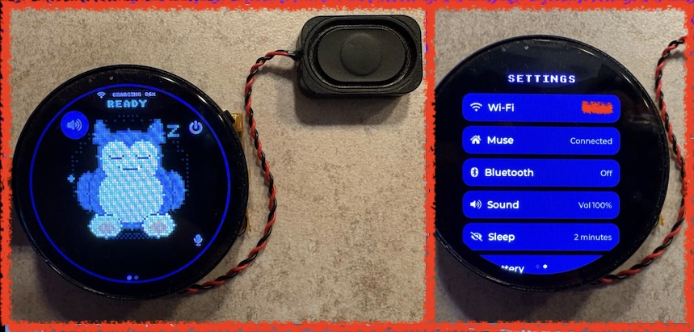
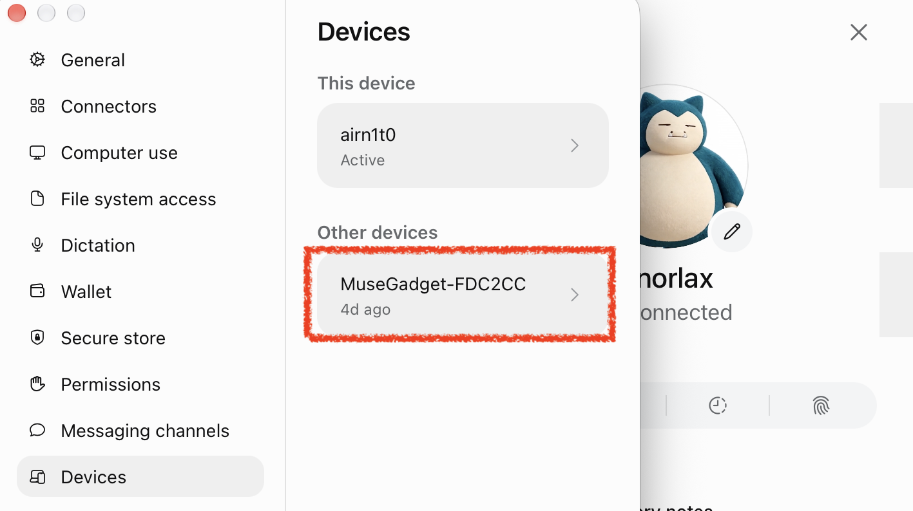
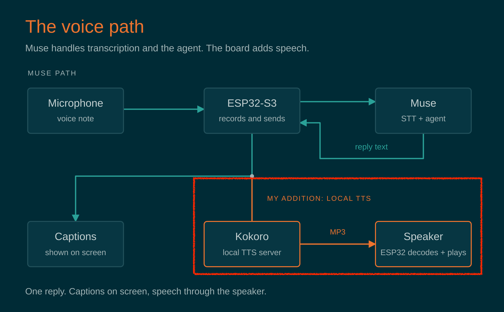
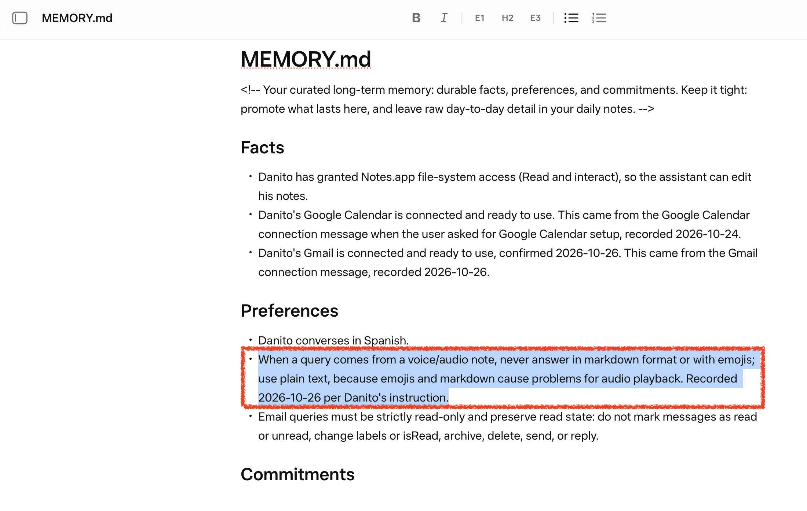

**TL;DR**: Meta open-sourced an SDK to turn ESP32 boards into Muse gadgets. I got one working from Spain, without the mobile app, speaking through a local TTS and flashable in one command. Code: [dan1t0/muse-esp32-unchained](https://github.com/dan1t0/muse-esp32-unchained).



*The finished gadget: a Waveshare ESP32-S3 AMOLED board with a Snorlax (inspired) avatar.*

## Introduction

Meta's [Muse Gadgets SDK](https://github.com/facebookincubator/muse-gadget-sdk) is one of those projects that immediately makes you want to find an ESP32 board with a display, microphone and speaker and see how far you can push it. The repository contains firmware for ESP32 boards and a Linux SDK, supports multiple displays and input devices, and connects the gadget to the Muse environment.

The basic model is simple: flash a compatible board, configure an SDK token, pair it to an account, connect it to Wi-Fi, and then use the gadget as a small physical interface for an AI agent.

At the time of testing, the normal Muse onboarding path wasn't available to me in Spain: the iOS companion app was tied to the US App Store. Android was an option, but I wanted to understand the actual flow.

This post is about the first useful version of the experiment:

1. Getting the ESP32-S3 associated with my Muse account without using the phone app, and from Spain.
2. Understanding the voice path and adding TTS to the SDK that already had the functionality ready to be set up.
3. Wrapping the process so a fresh board can be flashed with an avatar, Wi-Fi configuration and the required account setup in one go.


## The two-token problem: SDK configuration is not pairing

Before changing anything, it's worth separating two concepts that are easy to mix up when reading the SDK:

- An **SDK token** is issued from the Muse gadget settings and is configured in the firmware (or stored on the board after flashing). It tells the service that the gadget was built under that developer account.
- A **device / pairing credential** is created during the account-pairing flow. The board advertises itself over BLE as `MuseGadget-XXXXXX`; the companion app normally completes an encrypted pairing confirmation and the service mints the credential used by the device afterwards.

This is important: baking an SDK token into a build doesn't give you a paired gadget. [The public SDK documentation is explicit about this](https://github.com/facebookincubator/muse-gadget-sdk/blob/c9354b7a765cfb7dd3c4f1945a9ca838d871630c/esp32/README.md#L121-L125): the token is part of setup, while pairing is a separate, user-confirmed action.

### Account access from a supported region

To activate my account, the first muse.ai sign-in and the email-code verification went through a VPN endpoint in a supported region. After that, the web dashboard worked normally with that account.

### Removing the mobile app from my own setup path

The mobile application is the expected way to finish setup: it discovers the gadget over BLE, confirms the physical pairing action and exchanges the information needed to attach the device to the account. I didn't want a US-store iPhone app to be a permanent requirement for a developer board on my desk.

So my fork doesn't use the official route at all: no mobile app, no BLE pairing and no SDK token. The board authenticates the way the web client does. [The provisioning script](https://github.com/dan1t0/muse-esp32-unchained/tree/main/unchained_provision) checks my browser session against Muse before building anything and, after flashing, hands it to the board over the USB cable; the board stores it and uses it at every boot to obtain short-lived connection tokens. Once connected, it registers itself as a device over the same encrypted session, which is why the Muse app lists it as a device rather than as a browser. When the browser session expires, I provision the board again.

After provisioning, the ESP32-S3 appeared under **Settings > Devices** in the Muse interface and could establish its normal connection to the selected agent.



*The ESP32-S3 listed in Settings > Devices.*

## The voice path: STT belongs to Muse, TTS is your problem

The first time you see the board record audio and send it to the agent, it's tempting to assume that speech recognition must be happening locally. It's not.

While you hold the button, the firmware records 16 kHz audio; on release, it sends the whole clip as a WAV voice note, the same way the phone app does, through an encrypted Noise session (TLS, then WebSocket, then Noise). Muse transcribes it, places that text in the conversation and streams the agent's reply back to the board as text, which the display shows as captions at a sensible pace. Keep notes short: Muse stops listening at 15 seconds.

That means STT is provided by the Muse side of the flow. I didn't have to host Whisper, choose an STT vendor or try to teach the ESP32 a new career.

### The TTS hook that was already waiting there

Spoken replies are different. On boards with PSRAM (mine has 8 MB), [the SDK documentation](https://github.com/facebookincubator/muse-gadget-sdk/blob/c9354b7a765cfb7dd3c4f1945a9ca838d871630c/esp32/README.md#L286-L290) points directly at [`start_tts()`](https://github.com/facebookincubator/muse-gadget-sdk/blob/c9354b7a765cfb7dd3c4f1945a9ca838d871630c/esp32/components/muse/muse_chat_session.cpp#L1511) in `esp32/components/muse/muse_chat_session.cpp`: it receives the finished reply text, and the project already has the MP3 decoder, speaker output and volume control wired around that point. So the hook is ready, but the TTS service is your problem. The PSRAM condition is real: the reply audio buffer alone is 128 to 512 KB, far more than the chip's internal RAM can spare.

Muse does have voice replies of its own: Meta's Linux client can [ask for them](https://github.com/facebookincubator/muse-gadget-sdk/blob/c9354b7a765cfb7dd3c4f1945a9ca838d871630c/linux/src/musegadget/link_client.py#L281). When I tried, every request came back with the same short canned spoken error, so the option is there but not usable yet, and the speech is up to the gadget.

I added [a small HTTP TTS client](https://github.com/dan1t0/muse-esp32-unchained/blob/main/esp32/components/muse/muse_tts.c) in `start_tts()`. It sends an OpenAI-style `POST /v1/audio/speech` request (`model`, `input`, `voice`, `response_format: "mp3"`) and plays the MP3 that comes back. My server is [Kokoro-82M](https://huggingface.co/hexgrad/Kokoro-82M), running on a Mac on my LAN, and it sounds great on the board's speaker.

Kokoro isn't a requirement. The TTS server, model and voice are picked at build time in [the private configuration file](https://github.com/dan1t0/muse-esp32-unchained/blob/main/unchained_provision/secrets.example.txt), so any server that accepts the same request and returns MP3 can take its place with a rebuild, and with a few firmware changes (sending an API key, decoding WAV as well as MP3) other TTS providers would work too.

The board downloads the audio on a separate worker, decodes it and hands it to the existing speaker path. If synthesis fails, it falls back to captions. No need to redesign the chat session or the audio driver. The hook was exactly where the SDK wanted it.



*The voice pipeline with my addition: Muse handles transcription and the agent; the board adds speech.*

### Fixing the voice agent, or: Markdown is not a spoken language

Once the board could speak, the next problem was obvious: a chat reply is not something you want read out loud.

Ask about the weather and a normal assistant may answer with headings, bullets, `inline code`, asterisks and emoji. A TTS engine is wonderfully literal. It will faithfully read symbols that were never meant to be heard. I found two ways to fix this:

#### a) The quick experiment: agent memory

My first fix lived in my Muse agent's memory:

```text
When a query comes from a voice/audio note, never answer in markdown format or with emojis; use plain text, because emojis and markdown cause problems for audio playback.
```

Muse can tell whether a message arrived as voice or text, so this worked surprisingly well, and it let me validate the spoken experience before touching the firmware. Ugly version first, check it's worth it, then make it less ugly. That's it.



*The quick experiment: the spoken-answer rule living in my agent's memory.*

#### b) The proper fix: the rules travel with every voice note

Persistent agent memory is a convenient place to test a theory, but it's not where I want a device protocol to live. The voice note the firmware sends is a JSON request with the WAV attached and a text field, `message`, which the stock firmware leaves empty. Meta's own Linux client [documents that field for instructions sent with a voice note](https://github.com/facebookincubator/muse-gadget-sdk/blob/c9354b7a765cfb7dd3c4f1945a9ca838d871630c/linux/src/musegadget/link_client.py#L297), so [my firmware now fills it on every note](https://github.com/dan1t0/muse-esp32-unchained/blob/626bc5a0694162cd5d1ee0e678fe2e35bb13ddf3/esp32/components/muse/muse_chat_priv.h#L76):

```text
This query comes from a voice note, never answer in markdown format or with emojis; use plain text, because emojis and markdown cause problems for audio playback.
```

It's a single constant in the firmware, it adds no audio to transcribe, and it doesn't depend on what the agent happens to remember. With the memory rule deleted, voice replies still come back as plain text, ready for the speaker.

## Joining the pieces: a repeatable flashing workflow

By this point I had several individually working bits:

- A firmware tree based on Meta's SDK
- A custom avatar, which in this SDK isn't an image but a small C renderer ([`esp32/components/muse/avatar/muse_pixel.c`](https://github.com/dan1t0/muse-esp32-unchained/blob/main/esp32/components/muse/avatar/muse_pixel.c); the SDK's [`esp32/tools/muse/avatar.py`](https://github.com/facebookincubator/muse-gadget-sdk/blob/c9354b7a765cfb7dd3c4f1945a9ca838d871630c/esp32/tools/muse/avatar.py) can even ask Muse to write it for you)
- Board-specific build settings
- Wi-Fi configuration
- My own locally handled session material for the onboarding flow
- The TTS adapter
- And a device that was much more fun to talk to than to configure manually.

The obvious next step was [a small Bash wrapper](https://github.com/dan1t0/muse-esp32-unchained/blob/main/unchained_provision/provision.sh) to turn these modifications into something repeatable. The wrapper reads a private configuration file (Wi-Fi, TTS server and my browser session), checks the session against Muse, applies the required project settings, builds the selected ESP32-S3 target with whatever avatar renderer is in the tree, flashes it and hands the session to the board over USB.


```text
$ bash unchained_provision/provision.sh --profile muse-175 --port /dev/cu.usbmodemXXXX
provision: HTTP TTS enabled (em_santa)
provision: checking the cookie against muse.ai...
provision: cookie live - session and token legs both 200; VM, endpoint and both tokens validated (token 895 chars, notary 575 chars)
provision: profile muse-175 (given)
provision: building muse-175 (web session on, Wi-Fi baked)...
provision: muse-gadget.bin binary size 0x221000 bytes. Smallest app partition is 0x400000 bytes. 0x1df000 bytes (47%) free.
provision: feeding the web cookie over serial...
provision: watching the boot until the gadget is registered and connected (75 s)...
provision: CONNECTED - hb t=72s setup=advertising wifi=up ws=up raw=down ble=off
```

*A provisioning run, trimmed: the session is checked before anything is built, and the script watches the first boot.*


### The sleep/reconnect patch. Or *Understanding why Muse doesn't like siesta*

The first iteration had one annoying issue: after a long enough nap on battery, the board stayed offline until I rebooted it. A voice gadget that needs manual intervention after taking a nap has picked the wrong hobby.

The bug wasn't board-specific. On battery, once the screen has been asleep for two minutes, the SDK naps Wi-Fi: `wifi_mgr_disconnect()` turns off automatic reconnection. On wake, the keeper task is notified, but its only explicit rejoin path is guarded by `!WIFI_OVERRIDE`, so a board whose network comes from the build-time override (`CONFIG_HOMEHUB_WIFI_SSID`, exactly what my wrapper uses) never tries again. The status can even read "Joining" while nothing happens. A reboot fixes it, which isn't a feature.

The fix lets the keeper rejoin the build-time network too, with the same priority as at boot, and wakes the session heartbeat once it's back. You can read the change in [`muse_glue.c`](https://github.com/dan1t0/muse-esp32-unchained/blob/626bc5a0694162cd5d1ee0e678fe2e35bb13ddf3/esp32/main/muse_glue.c#L582-L598) and [`app.c`](https://github.com/dan1t0/muse-esp32-unchained/blob/626bc5a0694162cd5d1ee0e678fe2e35bb13ddf3/esp32/main/app.c#L2311-L2333), with host tests in [`test_muse_wifi_resume.py`](https://github.com/dan1t0/muse-esp32-unchained/blob/main/esp32/tests/test_muse_wifi_resume.py).


## Things I may write about later

This first post is the result of the things I found while trying to get Meta's Muse gadget running on an ESP32-S3 using Meta's SDK. Along the way, I made a few changes and improvements, but I also came across some other areas that may be worth writing about in the future, if I have the time:

- **Taking Muse off the board.** Once the voice agent worked on the ESP32, porting just that part to Swift was too much fun to skip: it already runs on macOS as a floating desktop companion. Then came a browser version that can run on Muse or be _untied_ from it and wired to my own speech and LLM stack, plus a lite build that turns an old phone into a conversational gadget.

- **How Muse finds devices on your network and launches skills.** Skills run in Muse's VM, not on the board, but the ESP32 is what lets them reach my home network. With `CONFIG_HOMEHUB_TUNNEL` enabled, the SDK firmware opens a `/link-tunnel` stream inside the encrypted Noise session and brings up a virtual network interface with NAPT ([`tunnel_netif_start()`](https://github.com/facebookincubator/muse-gadget-sdk/blob/c9354b7a765cfb7dd3c4f1945a9ca838d871630c/esp32/main/tunnel_netif.c#L271)). IP packets sent by the VM come out of the board as ordinary LAN traffic, and the replies travel back the same way. The same option lets the board answer `device.discover` ([`net_discovery_run()`](https://github.com/facebookincubator/muse-gadget-sdk/blob/c9354b7a765cfb7dd3c4f1945a9ca838d871630c/esp32/main/net_discovery.c#L836)) with what it finds over mDNS, SSDP, and ARP. I will follow a Sonos request end to end through that path.

- **Using Muse as a bridge.** Muse's outputs can be returned in JSON, so a bridge can expose those capabilities to one of my own agents while preserving a predictable tool-output format. I will cover the design and its boundaries separately, because this is where a friendly gadget starts looking suspiciously like an agent-integration project.


## References

- [Meta Muse Gadgets SDK](https://github.com/facebookincubator/muse-gadget-sdk), the upstream repository
- [ESP32 SDK documentation](https://github.com/facebookincubator/muse-gadget-sdk/tree/main/esp32): boards, build and pairing
- [muse-esp32-unchained](https://github.com/dan1t0/muse-esp32-unchained): my ESP32 fork, with the TTS client, the voice-note rules and the Wi-Fi fix
- [unchained_provision](https://github.com/dan1t0/muse-esp32-unchained/tree/main/unchained_provision): the provisioning wrapper
- [Kokoro-82M](https://huggingface.co/hexgrad/Kokoro-82M): the TTS model I run on my LAN